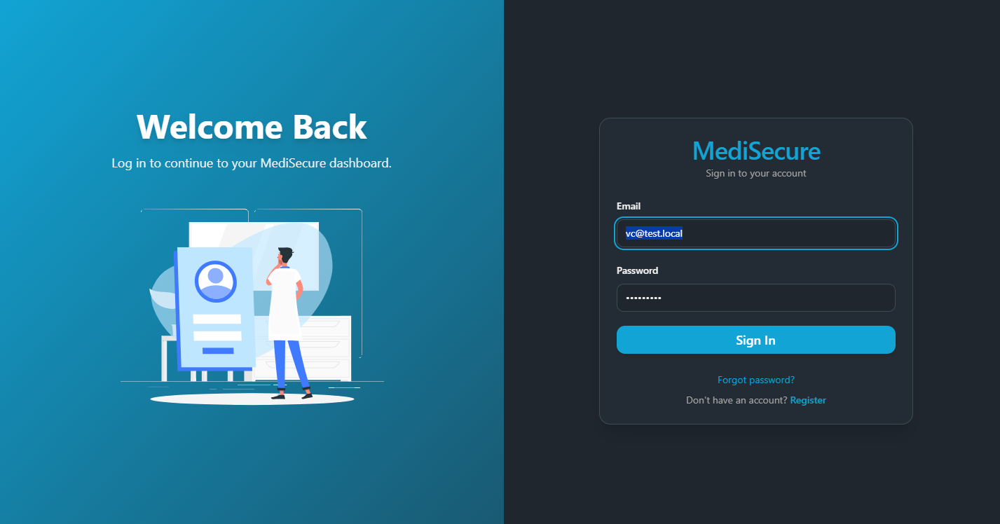
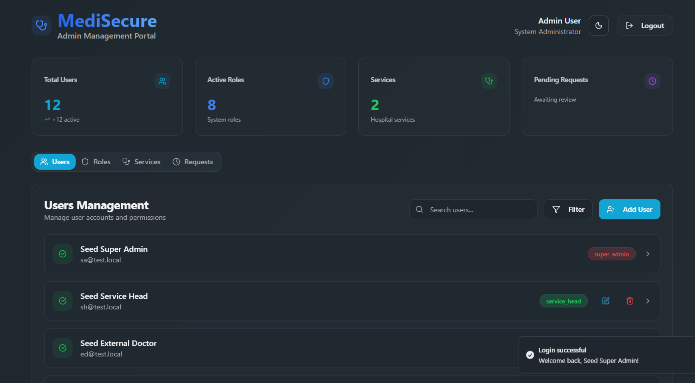
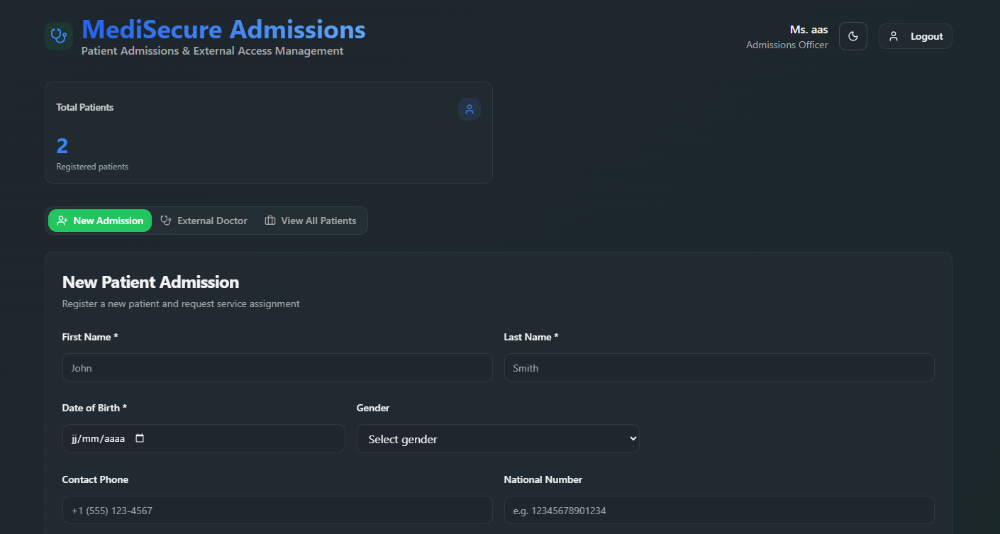
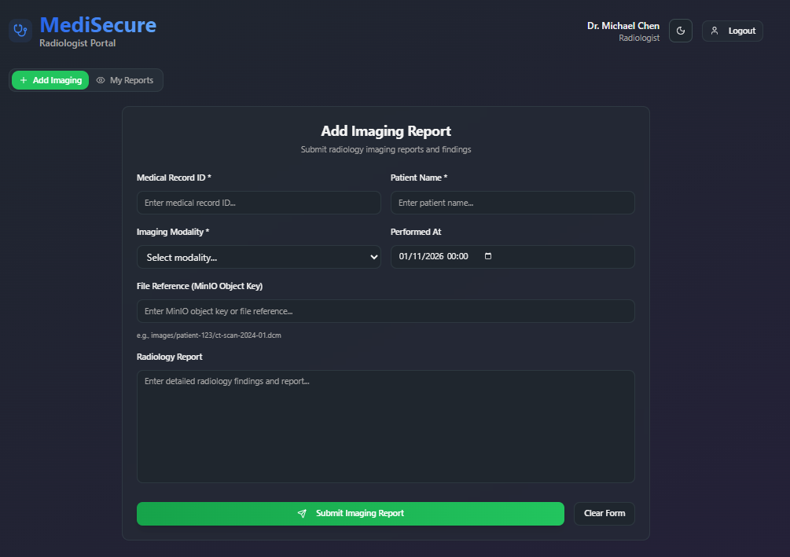
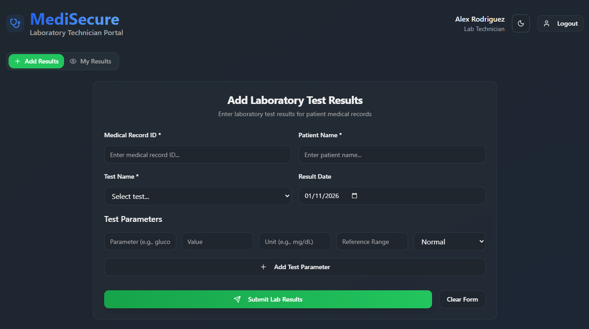

# MediCore HMS

MediCore HMS is a full-stack hospital management system for handling patients, clinical records, prescriptions, staff accounts, external-doctor access, and security auditing. It combines a React single-page application with a NestJS REST API and PostgreSQL, and enforces role-based access control on the server for every protected resource.



## Table of Contents

- [Features](#features)
- [Roles and Access](#roles-and-access)
- [Tech Stack](#tech-stack)
- [Architecture](#architecture)
- [Database Schema](#database-schema)
- [API Overview](#api-overview)
- [Security](#security)
- [Quick Start](#quick-start)
- [Environment Variables](#environment-variables)
- [Seed Demo Accounts](#seed-demo-accounts)
- [Testing](#testing)
- [Screenshots](#screenshots)
- [Known Limitations](#known-limitations)
- [Further Reading](#further-reading)

## Features

### Authentication and access control

- Email/password login with bcrypt password hashing.
- JWT access tokens with a 15-minute lifetime and refresh-token support.
- Login throttling, logout, profile retrieval, and refresh-token revocation.
- Eight server-enforced roles with deny-by-default authorization.
- Role assignment rules, including protection against removing the last super admin.
- Seeded development accounts for every role.

### User and role management

- Super-admin provisioning of staff accounts.
- Super-admin management of users, roles, and permissions.
- Service heads can manage users only within their own service and only for allowed roles.
- Service catalog management.
- Welcome-email delivery for newly provisioned accounts.

### Patient management

- Patient registration and demographic maintenance.
- Minimal patient listings that expose only id, first name, and family name.
- Search by patient name and date of birth, with an optional service filter.
- Service assignment and removal.
- Field-level encryption for phone number, national number, and insurance number.
- Automatic creation of an initial medical record for each patient.

### Clinical records and prescriptions

- Clinical records linked to patients and responsible doctors.
- Diagnoses, allergies, and free-text clinical notes.
- Prescription entries with medication, dose, frequency, and duration.
- Field-level encryption for clinical record content and prescription details.
- Role- and scope-aware read, create, update, and delete rules.
- Radiologist and laboratory technician access limited to assigned records.

### External-doctor access

- Public external-doctor access request form.
- Rate limiting, honeypot validation, duplicate-request checks, and non-enumerating responses.
- Super-admin approval and rejection workflow.
- Time-limited external accounts with expiry checking and deactivation.
- Patient sharing between approved external doctors and internal staff.
- Read-only clinical access for external doctors.

### Audit and monitoring

- Audit logging for authentication, patient access, records, and administrative actions.
- Security dashboard, threat view, statistics, and audit-log export.
- Verification-clerk access with PHI fields redacted.
- Audit entries capture actor, IP address, user agent, resource, and timestamp.

### Frontend

- Role-specific dashboards for administrators, service heads, doctors, admission agents, DPOs, radiologists, laboratory technicians, and external doctors.
- Responsive React interface built with Tailwind CSS and Radix UI primitives.
- Shared role constants and client-side hiding of actions the current role cannot perform.
- Friendly handling of 401, 403, and 404 responses.

## Roles and Access

| Role | Code | Primary access |
| --- | --- | --- |
| Super Admin | `super_admin` | Full system access, user/role/service management, provisioning, audit, email |
| Service Head | `service_head` | Reduced admin dashboard, users in own service, supervised patients and records |
| Internal Doctor | `internal_doctor` | Patients in own service or assigned records, clinical records |
| External Doctor | `external_doctor` | Shared patients only, read-only clinical access |
| Admission Agent | `admission_agent` | Patient intake, demographics, service assignment, external-request intake |
| Verification Clerk / DPO | `verification_clerk` | Audit logs, dashboard, threats, statistics, exports with PHI redacted |
| Radiologist | `radiologist` | Assigned imaging records only |
| Laboratory Technician | `laboratory_technician` | Assigned laboratory records only |

Authorization rules follow these principles:

- A missing token returns `401`.
- A valid token without the required role returns `403`.
- A resource outside the caller's scope returns `404` to avoid leaking its existence.
- Actor identity, author identity, and role always come from the token, never from the request body.
- The last super admin cannot be removed or demoted.
- External-doctor access requests are public but rate-limited and protected against enumeration.

## Tech Stack

| Layer | Technology |
| --- | --- |
| Frontend | React 19, Vite, React Router, Tailwind CSS, Radix UI, shadcn-style components, Axios, Framer Motion, Sonner, Lottie |
| Backend | NestJS 11, TypeScript, TypeORM, Passport JWT, bcrypt, class-validator, class-transformer, Nodemailer, Nest Throttler |
| Database | PostgreSQL |
| Testing | Jest, Supertest |
| Infrastructure | Docker, Docker Compose |
| Tooling | ESLint, Prettier, npm |

## Architecture

```text
React SPA (Vite, port 8080)
          |
          | REST/JSON + JWT
          v
NestJS API (port 3002)
  |-- Auth, users, roles, services
  |-- Patients, medical records, prescriptions
  |-- External-doctor requests and patient sharing
  |-- Audit logs and security reporting
  |-- SMTP email delivery
          |
          v
PostgreSQL (port 5432)
```

### Project structure

```text
new/
|-- backend/                 NestJS REST API
|   |-- src/
|   |   |-- admin/           Admin provisioning
|   |   |-- audit/           Audit logging and reporting
|   |   |-- auth/            Login, JWT guards, policies
|   |   |-- external-doctors/External access workflow
|   |   |-- mailer/          SMTP configuration
|   |   |-- medical-records/ Clinical records and prescriptions
|   |   |-- patients/        Patient management
|   |   |-- roles/           Roles and permissions
|   |   |-- services/        Hospital service catalog
|   |   |-- users/           User accounts and email
|   |   `-- common/          Enums, encryption, shared utilities
|   |-- scripts/             Development seed script
|   `-- test/                End-to-end tests
|-- frontend/                React single-page application
|   |-- src/
|   |   |-- components/      Shared UI and layout components
|   |   |-- contexts/        Authentication context
|   |   |-- lib/             API client, navigation, role constants
|   |   |-- pages/           Login, dashboards, management pages
|   |   `-- services/        API service modules
|   `-- public/
|-- Screenshots/             Application screenshots
|-- reports/                 RBAC phase reports
|-- docker-compose.yml
|-- .env.example             Compose-level database variables
`-- propmt.txt               Original README brief
```

## Database Schema

TypeORM entities define the following tables:

| Table | Purpose |
| --- | --- |
| `users` | Staff accounts, account state, service assignment, refresh token |
| `roles` | Canonical application roles |
| `permissions` | Permission catalog used by role management |
| `user_roles` | Many-to-many link between users and roles |
| `role_permissions` | Many-to-many link between roles and permissions |
| `services` | Hospital services and departments |
| `patients` | Patient demographics and encrypted identifiers |
| `patient_services` | Many-to-many link between patients and services |
| `medical_records` | Clinical records linked to patients and authors |
| `medical_record_doctors` | Many-to-many link between records and responsible doctors |
| `prescriptions` | Medication entries attached to clinical records |
| `external_doctor_requests` | External access requests, review status, and expiry |
| `external_doctor_patients` | Patients shared with approved external doctors |
| `audit_logs` | Security and activity audit trail |

In non-production environments, TypeORM creates and updates the schema automatically. Production deployments should disable schema synchronization and use migrations.

## API Overview

The API is served from `http://localhost:3002` by default. All protected routes require a bearer JWT.

| Prefix | Purpose |
| --- | --- |
| `/auth` | Login, token refresh, logout, profile |
| `/users` | First-admin registration, assignable roles, user CRUD |
| `/roles` | Role and permission management |
| `/services` | Service catalog management |
| `/patients` | Patient registration, search, details, service links, records |
| `/medical-records` | Clinical records, prescriptions, doctor assignment |
| `/external-doctors` | Public access requests, review, expiry, patient sharing |
| `/audit` | Audit log write, logs, dashboard, threats, statistics, export |
| `/admin` | Admin provisioning and user administration |
| `/email` | Outbound email for authorized administrators |

The server applies `JwtAuthGuard`, `RolesGuard`, and resource-level access policies. Endpoint-specific rules live in controllers, services, and policy files under each module.

## Security

- Passwords are hashed with bcrypt and never returned in API responses.
- Patient identifiers, clinical-record fields, and prescription details are encrypted with AES-256-CBC using `ENCRYPTION_KEY`.
- Request DTOs use whitelist validation and reject unknown fields.
- Global request throttling is enabled, with stricter limits for login and public external-doctor requests.
- Audit logs record authentication and patient-related activity.
- Verification clerks receive audit data with sensitive detail fields redacted.
- CORS, token issuance, role checks, and resource scope are enforced server-side.
- Secrets are read from environment variables and should never be committed.

## Quick Start

### Prerequisites

- Node.js 20 LTS or newer
- npm
- PostgreSQL 14 or newer, or Docker Desktop
- A local SMTP server or SMTP provider for email delivery

### Option 1: Local development

1. Configure the backend environment.

```powershell
cd new/backend
Copy-Item .env.example .env
```

Fill in the required values in `new/backend/.env`. The minimum local configuration needs database credentials, a 32-character `ENCRYPTION_KEY`, `JWT_SECRET`, `FRONTEND_URL`, and the SMTP settings. The example file may not contain every required key; use the [Environment Variables](#environment-variables) table as the checklist.

2. Start PostgreSQL.

```powershell
cd new
docker compose --env-file backend/.env up -d postgres
```

3. Install backend dependencies and prepare the database.

```powershell
cd new/backend
npm ci
npm run seed:dev
npm run start:dev
```

The seed script creates the demo users and sample records. It requires `SEED_PASSWORD` and refuses to run when `NODE_ENV=production`. If you prefer an empty database, skip seeding and create the first super admin through `POST /users/register` while the users table is empty.

4. Start the frontend in a second terminal.

```powershell
cd new/frontend
Copy-Item .env.example .env
npm ci
npm run dev
```

5. Open `http://localhost:8080`.

The backend listens on `http://localhost:3002`. The frontend reads the API base URL from `VITE_API_URL`.

### Option 2: Docker Compose

The included Compose file defines the frontend, backend, and PostgreSQL services.

```powershell
cd new
Copy-Item .env.example .env
docker compose up --build
```

Before using the full stack, wire the backend runtime environment variables into `docker-compose.yml` or an `env_file` for the backend service. The current Compose definition passes only the database variables to the backend; authentication, encryption, email, and frontend URL settings are also required.

For local development, starting only PostgreSQL with Compose and running the application processes natively is the simplest option.

## Environment Variables

Names are listed here without values. Never commit a populated `.env` file.

### Backend

| Variable | Required | Purpose |
| --- | --- | --- |
| `NODE_ENV` | No | Runtime mode; production disables TypeORM schema synchronization |
| `PORT` | No | API port; defaults to `3002` |
| `DB_HOST` | Yes | PostgreSQL host |
| `DB_PORT` | Yes | PostgreSQL port |
| `DB_USERNAME` | Yes | PostgreSQL username |
| `DB_PASSWORD` | Yes | PostgreSQL password |
| `DB_NAME` | Yes | PostgreSQL database name |
| `JWT_SECRET` | Yes | Signs access and refresh tokens |
| `ENCRYPTION_KEY` | Yes | 32-character AES-256 key for field encryption |
| `FRONTEND_URL` | Yes | Frontend URL used in welcome emails |
| `MAIL_HOST` | Yes | SMTP host |
| `MAIL_PORT` | Yes | SMTP port |
| `MAIL_SECURE` | No | Use implicit TLS for SMTP |
| `MAIL_USER` | Yes | SMTP username |
| `MAIL_PASS` | Yes | SMTP password or app password |
| `MAIL_FROM` | Yes | Sender address for outbound mail |
| `MAIL_TEST_RECIPIENT` | No | Redirects all development mail to one address |
| `THROTTLE_LOGIN_LIMIT` | No | Login attempts per window; defaults to `5` |
| `THROTTLE_LOGIN_TTL_MS` | No | Login throttle window in milliseconds; defaults to `60000` |
| `EXTERNAL_DOCTOR_REQUEST_LIMIT` | No | Public request limit per window |
| `EXTERNAL_DOCTOR_REQUEST_TTL_MS` | No | Public request throttle window |
| `SEED_PASSWORD` | Dev only | Password assigned by `npm run seed:dev` |
| `TEST_DB_NAME` | Test only | Database used by end-to-end tests |
| `TEST_DB_HOST` | Test only | Test database host |
| `TEST_DB_PORT` | Test only | Test database port |
| `TEST_DB_USERNAME` | Test only | Test database username |
| `TEST_DB_PASSWORD` | Test only | Test database password |

Generate the encryption key with:

```powershell
openssl rand -hex 16
```

### Frontend

| Variable | Required | Purpose |
| --- | --- | --- |
| `VITE_API_URL` | Yes | Backend API base URL, for example `http://localhost:3002` |

### Compose-level

The root `new/.env` supplies values used by `docker-compose.yml`:

| Variable | Purpose |
| --- | --- |
| `DB_HOST` | Database hostname used by the backend service |
| `DB_PORT` | Database port |
| `DB_USERNAME` | PostgreSQL username |
| `DB_PASSWORD` | PostgreSQL password |
| `DB_NAME` | PostgreSQL database name |

## Seed Demo Accounts

`npm run seed:dev` creates one development account per role. The password for every seeded account is the value of `SEED_PASSWORD`. The script only creates accounts that do not already exist and refuses to run in production.

| Role | Email |
| --- | --- |
| Super Admin | `sa@test.local` |
| Service Head | `sh@test.local` |
| Internal Doctor | `id@test.local` |
| External Doctor | `ed@test.local` |
| Admission Agent | `aa@test.local` |
| Verification Clerk | `vc@test.local` |
| Radiologist | `rad@test.local` |
| Laboratory Technician | `lab@test.local` |

These accounts are for local development only. Do not deploy them or reuse their credentials in a real environment.

## Testing

Run backend checks from `new/backend`:

```powershell
npm run lint
npm run test:unit
npm run test:e2e
npm run build
```

Run frontend checks from `new/frontend`:

```powershell
npm run lint
npm run build
```

The end-to-end tests require a test PostgreSQL database and the `TEST_DB_*` environment variables. The expected authorization matrix is:

| Case | Expected result |
| --- | --- |
| Valid role and in-scope resource | `2xx` |
| Missing or invalid token | `401` |
| Authenticated but wrong role | `403` |
| Resource outside the caller's scope | `404` |
| Invalid request body | `400` |

## Screenshots

| Login | Super Admin |
| --- | --- |
|  |  |

| Patient Admissions | Radiologist |
| --- | --- |
|  |  |

| Laboratory |
| --- |
|  |

## Known Limitations

- The 2FA and password-reset screens are frontend stubs; there are no backend endpoints for them yet.
- Refresh tokens are stored per user but are not rotated on every refresh, and there is no per-account lockout.
- New-account credentials are sent by email in plaintext. A one-time set-password link is a planned improvement.
- Patient list and search results are capped at 100 rows and are not paginated.
- CORS currently allows all origins and should be restricted before production deployment.
- The Compose backend service passes only database variables; a full-container deployment needs the remaining backend environment variables.
- The Dockerfiles use Node 18; update them to Node 20 or newer for NestJS 11 and current Vite releases.
- AES encryption has no automatic key-rotation mechanism.
- Production database migrations are not included; schema synchronization is enabled only outside production.

## Further Reading

- Role-assignment rules: `backend/src/auth/policy/role-assignment.rules.ts`
- Patient access policy: `backend/src/patients/policy/patient-access.policy.ts`
- Medical-record access policy: `backend/src/medical-records/policy/medical-record-access.policy.ts`
- RBAC verification reports: `reports/rbac-phase-5-report.md`, `reports/rbac-phase-6-report.md`
